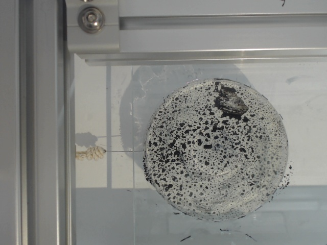
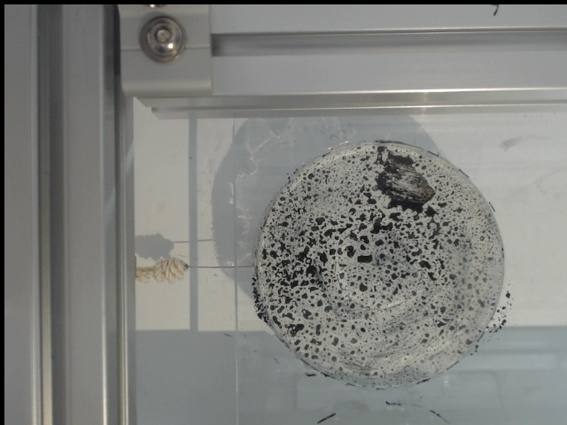

# Particle-Swarm-Optimization
```
+------------------------------------------------------------------+
|     Version     |                     Content                    |
+------------------------------------------------------------------+
|  V1.00.20260801 |  initial release for PSO                       |
+------------------------------------------------------------------+
```
Hybrid PSO: C-Core with Python Interface

Cost function: DIC ZNCC (Zero mean Normalized Cross-Correlation) correlation criteria

## Goal
Measure the target point displacement in image  
```
Target point(x,y) = (426,320)
```
## Image:
* reference image  
  

* deformed image (x:+5, y:+5) 
  

## How to run
```
python main.py
```

## Result  
```
Result: x=4.9, y=4.9, coefficient=0.9941199591792473
```
